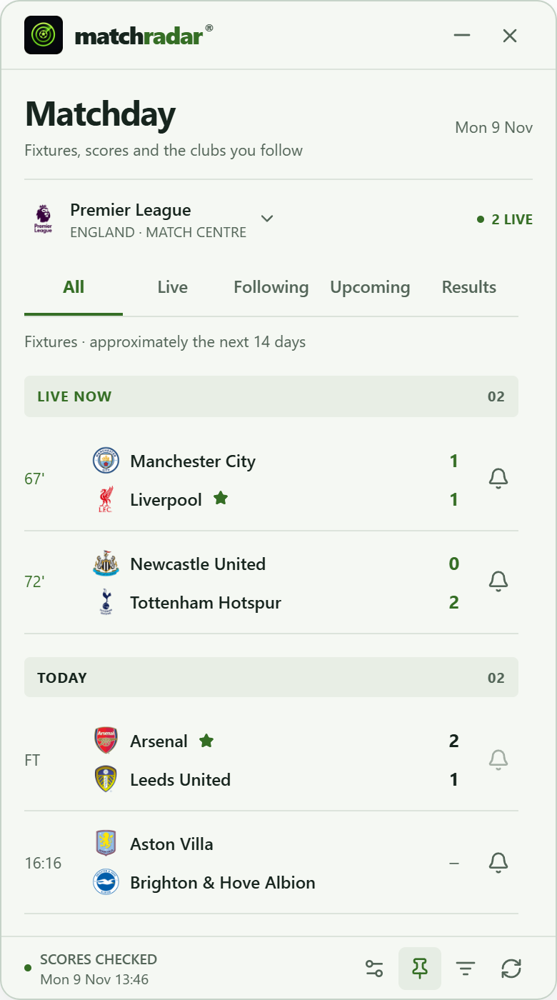

# MatchRadar

**Your matchday companion, right on your Windows desktop.**

MatchRadar is a compact football widget for keeping Premier League fixtures and scores in view while you work, browse, or play. Built with Tauri, Rust, and React, it puts the match list first and keeps your preferences and cached data locally.

> **Release candidate:** Version 1.0.0 is under development and is not yet a public release. Windows installers have built and launched; the remaining [native runtime checks](docs/VALIDATION.md) are still needed.

<table>
  <tr><th>Dark</th><th>Light</th></tr>
  <tr>
    <td></td>
    <td></td>
  </tr>
</table>

*Home screenshots show an earlier browser-rendered interface with labelled demo fixtures, not live scores or a native Windows capture. The current build also includes compact fixture filters.*

## At a glance

- **A widget for your desktop:** frameless, resizable, with compact and expanded views, adjustable background opacity, and dark or light themes.
- **Premier League at a glance:** live scores, upcoming fixtures, local kickoff times, competition context, and a league-wide live count. Follow clubs or filter the list to your favorites.
- **Match Centre:** open a card for an on-demand timeline, team statistics and lineups when ESPN supplies them. Scores remain sourced from the scoreboard.
- **Find the matches that matter:** switch between All, Live, Following, Upcoming and Results. Results can show completed Premier League games from the previous 14 days, with a separate cache.
- **Alerts that fit your matchday:** followed-team reminders and match-start alerts, optional goal alerts, and per-match subscribe, mute, or team-default settings.
- **Built for interruptions:** separate fixture and score refreshes, cached matches, stale-data indicators, retry handling, and a persistent notification queue.
- **Windows controls:** minimize to the taskbar, hide to the system tray, pin above other windows, and optionally launch at sign-in. See the [runtime checklist](docs/VALIDATION.md) for features still requiring packaged-app verification.
- **Privacy by design:** no account, API key, analytics, or telemetry. Preferences and cache stay on your device; ESPN requests and crest downloads require network access.

## Explore Match Centre


*Browser capture of the interface using a recorded completed-match response and mocked desktop IPC. It is not a live or packaged Windows screenshot. Timeline, Stats and Lineups appear only when the provider supplies data.*

## Install a Windows test build

MatchRadar targets **64-bit Windows 10 and 11** with the Microsoft Edge WebView2 runtime. Installer packaging runs on version tags and manual workflow dispatches; ordinary pushes run lint, tests, and the Rust checks without packaging. Supported versions and native integrations still require the runtime checks described below.

1. Sign in to GitHub with access to this private repository and open [Windows validation runs](https://github.com/awishtodiexz/MatchRadar/actions/workflows/windows.yml).
2. Select a successful run for the commit you want to test. Under **Artifacts**, download `matchradar-windows-installer`. Artifacts expire; an older run will not contain later changes.
3. Quit any running MatchRadar instance from its tray menu. Extract the ZIP and run `MatchRadar_1.0.0_x64-setup.exe`.
4. Launch MatchRadar and use the [Windows runtime checklist](docs/VALIDATION.md) to test the installer. The installer is unsigned and Windows may display a reputation prompt.

No public release is available yet.

## Develop

Install Node.js 22 and npm, stable Rust, Microsoft C++ build tools, and WebView2. Follow the official [Tauri 2 prerequisites](https://v2.tauri.app/start/prerequisites/) for Windows.

```powershell
npm ci
npm run tauri dev
```

For a browser shell preview, run `npm run dev`. Match data and native controls require the desktop app. Browser verification injects test-only fixtures through mocked IPC and does not validate notifications, tray behavior, or native window sizing.

```powershell
npm run lint
npm test
npm run build
cargo fmt --manifest-path src-tauri/Cargo.toml -- --check
cargo test --locked --manifest-path src-tauri/Cargo.toml
```

To build a Windows installer locally, run `.\scripts\build-local.ps1`. It loads the Visual Studio C++ environment, keeps compiler temporary files inside `src-tauri/target`, runs lint, tests, and the frontend build, and prints the installer path and SHA-256. The NSIS output is placed under `src-tauri/target/release/bundle/nsis/`. If your shell already has the MSVC environment loaded, `npm run tauri build` alone is enough. Use `npm.cmd` in PowerShell if script execution policy blocks `npm`; run the script through `powershell -ExecutionPolicy Bypass -File .\scripts\build-local.ps1` if needed.

## Find your way around the code

| Area | Start here |
| --- | --- |
| Widget shell and navigation | `src/App.tsx` |
| Match details and centre | `src/components/MatchDetails.tsx`, `src/components/MatchCentre.tsx` |
| UI state and native contracts | `src/store.ts`, `src/types.ts` |
| Native entry point and integration | `src-tauri/src/main.rs` |
| ESPN, summaries and results | `src-tauri/src/provider.rs`, `src-tauri/src/details.rs`, `src-tauri/src/results.rs` |
| Cache and notification reliability | `src-tauri/src/persistence.rs`, `src-tauri/src/alerts.rs`, `src-tauri/src/delivery.rs` |

See the [documentation index](docs/README.md) for the full map and historical evidence.

## Technology

Tauri 2 and Rust handle the native window, background fetching, persistence, and notifications. The interface uses React, TypeScript, Vite, Tailwind CSS, Zustand, and Lucide icons. Vitest and React Testing Library cover frontend behavior; Rust tests cover native domain and reliability logic.

## Validation and limitations

The [Windows workflow](.github/workflows/windows.yml) runs lint, frontend tests, the TypeScript/Vite build, Rust formatting and tests on every code change, and builds and uploads the Tauri installer for version tags and manual dispatches. The [validation notes](docs/VALIDATION.md) record what has been tested and the remaining Windows checks. A passing build does not prove notification delivery, startup, tray restoration, scaling, sleep/resume, or multi-monitor recovery.

- Match Centre events, statistics and lineups depend on provider availability; live/halftime summary shapes still need real-match validation.
- Dedicated off-screen window recovery is not implemented. HTTP-date and numeric `Retry-After` are parsed; cooldowns are process-local. Sleep/resume behavior and real notification delivery need further validation.
- Provider outages and changes can affect coverage. Cached data can be stale; the widget labels unconfirmed scores accordingly.
- Performance has not been benchmarked for release.

## Data, assets, and public release

Scores and fixtures come from ESPN's **unofficial, undocumented** public JSON endpoints. Their availability, format, rate limits, and usage rights are not guaranteed; MatchRadar is not affiliated with ESPN or the Premier League. Team crests load from ESPN's CDN when available, with initials as a fallback. The competition shield is original MatchRadar artwork. See [data provider notes](docs/DATA_PROVIDER.md).

Before public distribution, select and add a software license, review rights and terms for football data and third-party crests, establish appropriate permissions or replacements, sign the Windows installer, and complete the [release and runtime checks](docs/VALIDATION.md). No distribution rights are asserted here.

## Documentation

[Documentation index](docs/README.md) ? [Product](docs/PRODUCT.md) · [Architecture](docs/ARCHITECTURE.md) · [Design system](docs/DESIGN_SYSTEM.md) · [Data provider](docs/DATA_PROVIDER.md) · [Validation](docs/VALIDATION.md) · [Audit](docs/V1_COMPREHENSIVE_AUDIT.md) · [Roadmap](docs/ROADMAP.md) · [Changelog](CHANGELOG.md)
