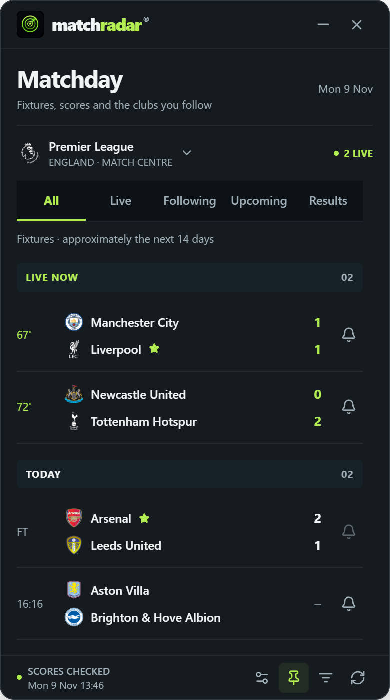

# MatchRadar

[](https://github.com/awishtodiexz/MatchRadar/actions/workflows/windows.yml)

**Your matchday companion, right on your Windows desktop.**

MatchRadar is a compact Premier League and Champions League widget that keeps
fixtures and scores in view while you work, browse, or play. It is built with
Tauri 2, Rust, React, and TypeScript, keeps preferences and cached data local,
and ships as a small NSIS installer for 64-bit Windows 10/11.

**Requirements:** 64-bit Windows 10/11 with the Microsoft Edge WebView2 runtime.

> **Release status:** [v1.1.0](https://github.com/awishtodiexz/MatchRadar/releases/tag/v1.1.0)
> is available as a private release for repository collaborators with the
> Premier League + Champions League update. Public distribution is pending the
> remaining [native runtime checks](docs/VALIDATION.md).

## Screenshots

<table>
  <tr><th>Widget</th><th>Match Centre</th></tr>
  <tr>
    <td></td>
    <td></td>
  </tr>
</table>

*Browser renders from the current build using test fixtures and crests from
ESPN's CDN. They are not packaged Windows captures.*

## What it does

- **Widget first:** frameless and resizable, with compact and expanded views,
  adjustable background opacity, dark and light themes, always-on-top, tray
  controls, and optional launch at sign-in.
- **Two competitions at a glance:** switch between Premier League, Champions
  League, or Both. The choice persists; Both shows one chronological list with a
  small PL/UCL tag per card, and the live count follows the selection. UCL looks
  30 days ahead so sparse fixtures still appear. Follow a club once — ESPN uses
  the same ID in both competitions, so its UCL matches and alerts come along.
- **Match Centre:** on-demand timeline, team statistics, and lineups for either
  competition when ESPN supplies them. Scores remain sourced from the scoreboard.
- **Views that fit matchday:** All, Live, Following, Upcoming, and Results.
  Results covers completed matches from the previous 14 days with a separate
  per-competition cache.
- **Alerts:** followed-team reminders, match-start and optional goal alerts for
  both competitions, per-match subscribe/mute, persistent deduplication, and a
  durable retry queue. Alerts keep monitoring both leagues regardless of the
  competition you are viewing.
- **Built for interruptions:** independent fixture and score refreshes, offline
  cache, stale-data labels, retry/backoff handling, and automatic recovery when
  a display change leaves the widget off-screen.
- **Private by design:** no account, API key, analytics, or telemetry.
  Preferences and cache stay on the device; ESPN requests and crest downloads
  need network access.

## Install

MatchRadar targets 64-bit Windows 10/11 with the Microsoft Edge WebView2 runtime.

1. Open the private [v1.1.0 release](https://github.com/awishtodiexz/MatchRadar/releases/tag/v1.1.0)
   and download `MatchRadar_1.1.0_x64-setup.exe`.
2. Quit any running MatchRadar instance from its tray menu.
3. Run the installer and launch MatchRadar. The installer is unsigned, so
   Windows may show a reputation prompt.
4. Work through the [Windows runtime checklist](docs/VALIDATION.md).

For unreleased commits, download the `matchradar-windows-installer` artifact from
a successful [Windows validation run](https://github.com/awishtodiexz/MatchRadar/actions/workflows/windows.yml).
Installer packaging runs on `v*` tags and manual dispatches; ordinary pushes run
checks without packaging. Artifacts expire.

## Develop

Install Node.js 22 and npm, stable Rust, the Microsoft C++ build tools, and
WebView2. Follow the official [Tauri 2 prerequisites](https://v2.tauri.app/start/prerequisites/)
for Windows.

```powershell
npm ci
npm run tauri dev        # native app with live IPC
npm run dev              # browser shell with test fixtures
```

Browser previews use test-only fixtures and mocked IPC; they do not validate
native notifications, tray behavior, or window sizing.

```powershell
npm run verify:fast      # lint + frontend tests + production build
cargo fmt --manifest-path src-tauri/Cargo.toml -- --check
cargo test --locked --manifest-path src-tauri/Cargo.toml
```

To build the installer locally, run `.\scripts\build-local.ps1`. It loads the
Visual Studio environment, keeps MSVC temp files inside `src-tauri/target`, runs
the checks, and prints the installer path and SHA-256. Output lands in
`src-tauri/target/release/bundle/nsis/`. If the MSVC environment is already
loaded, `npm run tauri build` is enough. If PowerShell blocks unsigned scripts,
run `powershell -ExecutionPolicy Bypass -File .\scripts\build-local.ps1`.

## Project layout

| Area | Start here |
| --- | --- |
| Widget shell and navigation | `src/App.tsx` |
| Match details and centre | `src/components/MatchDetails.tsx`, `src/components/MatchCentre.tsx` |
| UI state and native contracts | `src/store.ts`, `src/types.ts` |
| Native entry point and integration | `src-tauri/src/main.rs` |
| ESPN, summaries and results | `src-tauri/src/provider.rs`, `src-tauri/src/details.rs`, `src-tauri/src/results.rs` |
| Cache and notification reliability | `src-tauri/src/persistence.rs`, `src-tauri/src/alerts.rs`, `src-tauri/src/delivery.rs` |

Tauri and Rust own the native window, networking, persistence, notifications, and
background refresh. The interface uses React, TypeScript, Vite, Tailwind CSS,
Zustand, and Lucide icons. Vitest and React Testing Library cover frontend
behavior; Rust tests cover native domain and reliability logic.

## Validation and limitations

CI runs lint, frontend tests, the TypeScript/Vite build, Rust formatting, and Rust
tests on pushes and pull requests; installers are packaged only for `v*` tags and
manual dispatches. See the [validation notes](docs/VALIDATION.md) for current
evidence. A passing build does not prove runtime behavior.

- Match Centre events, statistics, and lineups depend on provider availability;
  live and halftime summary shapes still need real-match validation. The UCL
  scoreboard and one completed UCL summary were verified on 6 November 2026, but
  UCL live/halftime details still need a real match.
- Off-screen window recovery runs after display changes but still needs packaged
  Windows verification; `Retry-After` cooldowns are process-local. Sleep/resume
  and real notification delivery need validation.
- Provider outages can reduce coverage. Cached data can be stale, and the widget
  labels unconfirmed scores accordingly.
- Performance has not been benchmarked for release.

## Data, assets, and licensing

Scores and fixtures come from ESPN's **unofficial, undocumented** public JSON
endpoints for the Premier League and Champions League. Availability, format,
rate limits, and usage rights are not guaranteed; MatchRadar is not affiliated
with ESPN, the Premier League, or UEFA. Crests load from
ESPN's CDN when available, with initials as a fallback; the competition marks are
original artwork. See [data provider notes](docs/DATA_PROVIDER.md).

**License:** none selected yet. The repository is private and no distribution
rights are granted.

Before public distribution, add a software license, review rights for football
data and third-party crests, sign the installer, and complete the
[release and runtime checks](docs/VALIDATION.md).

## Documentation

[Index](docs/README.md) · [Product](docs/PRODUCT.md) · [Architecture](docs/ARCHITECTURE.md) ·
[Design system](docs/DESIGN_SYSTEM.md) · [Data provider](docs/DATA_PROVIDER.md) ·
[Validation](docs/VALIDATION.md) · [Releasing](docs/RELEASING.md) · [Roadmap](docs/ROADMAP.md) ·
[Changelog](CHANGELOG.md) · [Handoff](HANDOFF.md) · [Archive](docs/archive/README.md)
