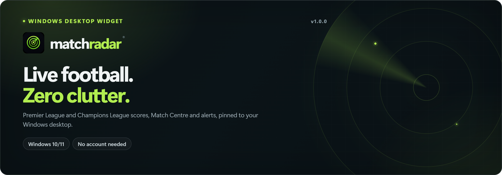
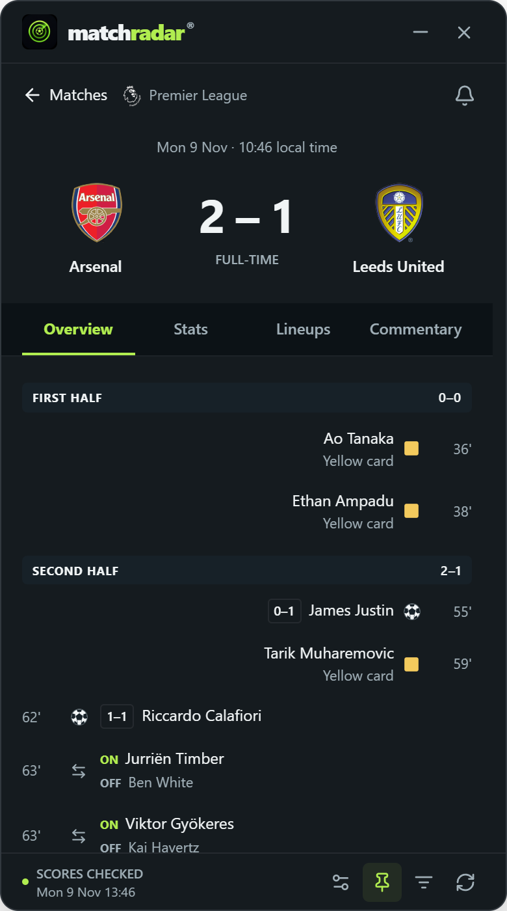
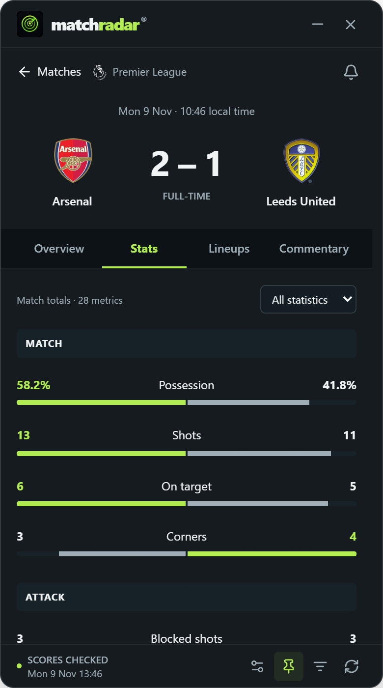

<div align="center">
  
</div>

<p align="center">
  <a href="https://github.com/awishtodiexz/MatchRadar/actions/workflows/windows.yml"></a>
  
  
  
  
</p>

<p align="center">
  <picture>
    <source media="(prefers-color-scheme: dark)" srcset="docs/screenshots/widget-dark.png">
    <source media="(prefers-color-scheme: light)" srcset="docs/screenshots/widget-light.png">
    
  </picture>
  <picture>
    <source media="(prefers-color-scheme: dark)" srcset="docs/screenshots/match-centre-overview.png">
    <source media="(prefers-color-scheme: light)" srcset="docs/screenshots/match-centre-overview-light.png">
    
  </picture>
</p>

<p align="center">
  <sub><strong>Widget</strong> · scores at a glance &nbsp;·&nbsp; <strong>Match Centre</strong> · the full story</sub><br>
  <sub>Screenshots use sample match data.</sub>
</p>

MatchRadar keeps scores, fixtures and the clubs you follow in a small window that stays with you while you work. Open any match for a Match Centre built around one scoreboard: a compact incident timeline, match statistics, lineups and full commentary. Preferences and cached data stay on your device, and there is no account to create.

| **Platform** | **Competitions** | **Built with** | **Privacy** |
| :---: | :---: | :---: | :---: |
| Windows 10/11 (64-bit) | Premier League · Champions League | Tauri 2 · Rust · React | Local cache · no account · no telemetry |

## Features

- **Live at a glance.** Follow the Premier League, Champions League, or both. Scores, kick-off times and independent refresh status stay in view.
- **A proper Match Centre.** Goals, cards and substitutions by half, provider stats with comparison bars, formation lineups, and filtered commentary in the same compact window.
- **Clubs, not accounts.** Follow a club once across both competitions. Get reminders, match-start alerts and optional goal alerts, with per-match mute when you need quiet.
- **Tray-first by design.** Both window controls hide to the tray. Toggle with `Ctrl+Shift+M`, pin above other windows, start hidden at sign-in, and recover automatically if a monitor disappears.
- **Private by design.** No account, API key, analytics or telemetry. Preferences and cached data stay on your device; live scores and match details are fetched from ESPN.

<details>
<summary>More screenshots</summary>

<p align="center">
  <picture>
    <source media="(prefers-color-scheme: dark)" srcset="docs/screenshots/match-centre-stats.png">
    <source media="(prefers-color-scheme: light)" srcset="docs/screenshots/match-centre-stats-light.png">
    
  </picture>
</p>

</details>

## Install

**Windows 10/11 (64-bit)** with the [WebView2 runtime](https://developer.microsoft.com/microsoft-edge/webview2/).

1. Download the latest installer from [Releases](https://github.com/awishtodiexz/MatchRadar/releases/latest).
2. Quit any running MatchRadar instance from the tray.
3. Run the installer and launch MatchRadar.

The installer is unsigned, so Windows may show a SmartScreen warning. If it does, choose **More info → Run anyway**. The release page includes the installer's SHA-256 checksum. There is no auto-updater yet; future versions install over the current one.

## Development

You will need Node.js 22, stable Rust with the MSVC toolchain, the Visual Studio C++ build tools, WebView2, and Microsoft Edge for the Playwright checks. See the [Tauri 2 prerequisites](https://v2.tauri.app/start/prerequisites/) for details.

```powershell
npm ci
npm run tauri dev        # native app
npm run dev              # frontend shell; native data is desktop-only
```

```powershell
npm run verify:fast      # version check, lint, frontend tests and production build
npm run verify:ui        # Playwright journeys and accessibility checks
cargo fmt --manifest-path src-tauri/Cargo.toml -- --check
cargo test --locked --manifest-path src-tauri/Cargo.toml
```

Rust tests need the Visual Studio C++ environment; run them from a Developer PowerShell, or use `.\scripts\build-local.ps1`, which loads it and builds the NSIS installer. Tauri and Rust own the native window, networking, persistence, notifications and background refresh; React renders the interface. `npm run screenshots` rebuilds the banner and images above.

## Contributing

Found a bug or have an idea? [Open an issue](https://github.com/awishtodiexz/MatchRadar/issues). Code changes are welcome — run the commands under Development, including the Rust checks, before opening a pull request.

For security reports, follow [SECURITY.md](.github/SECURITY.md) instead of opening a public issue.

## Data

Fixtures, scores and match details come from ESPN's **unofficial, undocumented** public JSON endpoints. Availability, accuracy and usage rights are not guaranteed.

MatchRadar is not affiliated with ESPN, the Premier League or UEFA. Club crests and competition badges load from ESPN's CDN, with initials as an offline fallback.

---

<p align="center">
  <sub><a href="CHANGELOG.md">Changelog</a> · <a href="https://github.com/awishtodiexz/MatchRadar/releases">Releases</a> · <a href="https://github.com/awishtodiexz/MatchRadar/issues">Issues</a></sub>
</p>
