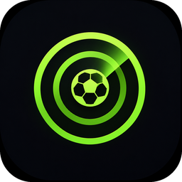
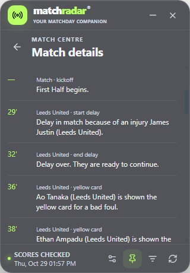

# MatchRadar

<p align="center"></p>

[](https://github.com/awishtodiexz/MatchRadar/actions/workflows/windows.yml)

**Your matchday companion, right on your Windows desktop.**

MatchRadar is a compact Premier League and Champions League widget that keeps
fixtures and scores in view while you work, browse, or play. It is built with
Tauri 2, Rust, React, and TypeScript, keeps preferences and cached data local,
and ships as a small NSIS installer for 64-bit Windows 10/11.

**Requirements:** 64-bit Windows 10/11 with the Microsoft Edge WebView2 runtime.

> **Release status:** local v1.1.0 builds. The installer is unsigned and there is
> no auto-updater — install a newer build over the old one to update. Public
> distribution is pending the remaining
> [native runtime checks](#windows-acceptance).

## Screenshots

<table>
  <tr><th>Widget</th><th>Match Centre</th></tr>
  <tr>
    <td></td>
    <td></td>
  </tr>
</table>

*Browser renders from the current build using test fixtures and crests from
ESPN's CDN. They are not packaged Windows captures.*

## What it does

- **Widget first:** frameless and resizable, with compact and expanded views,
  adjustable background opacity, dark and light themes, always-on-top, and tray
  controls. The widget lives in the system tray: minus and close both hide it
  there, clicking the tray icon toggles it, and `Ctrl+Shift+M` does the same from
  anywhere. Launch at sign-in, optionally starting hidden in the tray.
- **Two competitions at a glance:** switch between Premier League, Champions
  League, or Both. The choice persists; Both shows one chronological list with a
  small PL/UCL tag per card, and the live count follows the selection. UCL looks
  30 days ahead so sparse fixtures still appear. Follow a club once — ESPN uses
  the same ID in both competitions, so its UCL matches and alerts come along.
- **Match Centre:** on-demand Overview with scorers and key stats, a
  commentary-rich timeline by half, team-tabbed lineups with formations and
  shirt numbers, plus team statistics for either competition. Scores remain
  sourced from the scoreboard.
- **Views that fit matchday:** All, Live, Following, Upcoming, and Results.
  Results covers completed matches from the previous 14 days with a separate
  per-competition cache.
- **Alerts:** followed-team reminders, match-start and optional goal alerts for
  both competitions, per-match subscribe/mute, persistent deduplication, and a
  durable retry queue. Alerts keep monitoring both leagues regardless of the
  competition you are viewing.
- **Built for interruptions:** independent fixture and score refreshes, offline
  cache, stale-data labels, retry/backoff handling, automatic recovery when a
  display change leaves the widget off-screen, and an immediate refresh after the
  machine wakes from sleep.
- **Private by design:** no account, API key, analytics, or telemetry.
  Preferences and cache stay on the device; ESPN requests and crest/badge
  downloads need network access.

## Install

MatchRadar targets 64-bit Windows 10/11 with the Microsoft Edge WebView2 runtime.

1. Build the local installer with `.\scripts\build-local.ps1` and use
   `MatchRadar_1.1.0_x64-setup.exe`, or download a private local-build artifact
   from a successful [Windows validation run](https://github.com/awishtodiexz/MatchRadar/actions/workflows/windows.yml).
2. Quit any running MatchRadar instance from its tray menu.
3. Run the installer and launch MatchRadar. The installer is unsigned, so
   Windows may show a reputation prompt.
4. Work through the [Windows acceptance checks](#windows-acceptance).

Installer packaging runs on `v*` tags and manual dispatches; ordinary pushes run
checks without packaging. Artifacts expire.

## Develop

Install Node.js 22 and npm, stable Rust, the Microsoft C++ build tools, and
WebView2. Follow the official [Tauri 2 prerequisites](https://v2.tauri.app/start/prerequisites/)
for Windows.

```powershell
npm ci
npm run tauri dev        # native app with live IPC
npm run dev              # browser shell with test fixtures
```

Browser previews use test-only fixtures and mocked IPC; they do not validate
native notifications, tray behavior, or window sizing.

```powershell
npm run verify:fast      # version check, lint, frontend tests, production build
npm run verify:ui        # production build + Playwright journeys
cargo fmt --manifest-path src-tauri/Cargo.toml -- --check
cargo test --locked --manifest-path src-tauri/Cargo.toml
```

`npm run verify:ui` runs Playwright at 320px and 390px with mocked IPC. Rust
tests need the Visual Studio C++ environment; `.\scripts\build-local.ps1` loads
it and keeps MSVC temp files under `src-tauri/target/.build-temp`.

To build the installer locally, run `.\scripts\build-local.ps1`. It loads the
Visual Studio environment, runs the checks, and prints the installer path and
SHA-256. Output lands in `src-tauri/target/release/bundle/nsis/`. If PowerShell
blocks unsigned scripts, run
`powershell -ExecutionPolicy Bypass -File .\scripts\build-local.ps1`.

## Architecture

Tauri and Rust own the native window, networking, persistence, notifications,
and background refresh. React reads normalized snapshots through Tauri commands
and subscribes to native snapshot events; it does not own a second preference
store, and polling does not depend on a mounted component.

- **Provider:** ESPN's unofficial JSON endpoints for the Premier League
  (`eng.1`) and Champions League (`uefa.champions`). Fixture queries use monthly
  scoreboards (14-day PL window, 30-day UCL window); scores use daily queries at
  the adaptive live cadence. Date-range requests are not supported.
- **Refresh:** each competition refreshes and reports status independently.
  Successful fixtures, scores, results and summaries merge by stable provider
  ID. A failed or malformed source keeps the previous cache; one competition's
  failure never erases the other's data.
- **Persistence:** preferences, caches, notification queues and window state
  live in one local JSON snapshot. Saves use atomic replacement, a validated
  backup and corruption recovery.
- **Notifications:** events are planned deterministically, persisted before
  submission and retried with bounded backoff. Delivery is best-effort; a
  successful native call is not proof the OS displayed it.
- **Window recovery:** placement is a pure rectangle calculation. Recovery runs
  after restore, on focus/scale changes and from a watchdog, centring a widget
  that no monitor shows at least 64×48 physical pixels of.

## Project layout

| Area | Start here |
| --- | --- |
| Widget shell and navigation | `src/App.tsx` |
| Match details and centre | `src/components/MatchCentre.tsx`, `src/components/MatchDetails.tsx` |
| UI state and native contracts | `src/store.ts`, `src/types.ts`, `src/presentation.ts` |
| Local-day, summary and results hooks | `src/useLocalDay.ts`, `src/useMatchSummary.ts`, `src/useRecentResults.ts` |
| Native entry point and lifecycle | `src-tauri/src/main.rs` |
| ESPN transport and refresh | `src-tauri/src/provider.rs`, `src-tauri/src/refresh.rs`, `src-tauri/src/results.rs` |
| Match summaries and lineups | `src-tauri/src/details.rs` |
| Models and atomic persistence | `src-tauri/src/model.rs`, `src-tauri/src/persistence.rs` |
| Notifications and scheduling | `src-tauri/src/alerts.rs`, `src-tauri/src/delivery.rs`, `src-tauri/src/scheduling.rs` |
| Window sizing and recovery | `src-tauri/src/window.rs` |
| Native configuration | `src-tauri/tauri.conf.json`, `src-tauri/capabilities/default.json` |

The interface uses React, TypeScript, Vite, Tailwind CSS, Zustand and Lucide
icons. Vitest and React Testing Library cover frontend behavior; Rust tests
cover native domain and reliability logic.

## UI conventions

- Dark is the default; light is optional. Both themes use the same semantic
  variables in `src/styles.css`: charcoal glass and lime for dark, pale surfaces
  and deeper green for light. Do not fork layouts per theme.
- Inspect at 320px (minimum) and 390px. Keep one intended scroll region per view,
  stable tabular scores and one-line match rows with initials crest fallbacks.
- Panel opacity applies to backgrounds, never text or controls. Content must stay
  readable at 70% opacity over bright and dark wallpapers.
- Preserve keyboard navigation, visible focus, accessible names and reduced
  motion. Match Centre and Settings use the WAI-ARIA tabs pattern.

## Validation and limitations

CI runs lint, frontend tests, the TypeScript/Vite build, the Playwright journeys
(including the axe accessibility pass), Rust formatting and Rust tests on pushes
and pull requests; installers are packaged only for `v*` tags and manual
dispatches. A passing build does not prove runtime behavior.

- Match Centre events, statistics and lineups depend on provider availability;
  live and halftime summary shapes still need real-match validation. The UCL
  scoreboard and one completed UCL summary were verified on 6 November 2026, but
  UCL live/halftime details still need a real match.
- Off-screen window recovery runs after display changes but still needs packaged
  Windows verification; `Retry-After` cooldowns are process-local. A sleep/resume
  watchdog now forces a refresh after the machine wakes; packaged notification
  delivery still needs validation.
- Provider outages can reduce coverage. Cached data can be stale, and the widget
  labels unconfirmed scores accordingly.
- Development-build measurements on this machine: 98 frontend tests, 111 Rust
  tests and 33 Playwright journeys; the widget's full state is ~170KB, scoreboard
  responses are ~6KB compressed versus ~70KB identity, and crests use 96px
  combiner images instead of 500px assets. Packaged memory/CPU were not profiled.

### Windows acceptance

Before calling a build release-ready, install the packaged NSIS build and record
the commit, OS version, display scale, theme, opacity and result for each check:

- Minus and X both hide to the tray; there is no taskbar button. Tray Show/Hide,
  the tray-icon toggle, `Ctrl+Shift+M`, Settings, Quit and second-instance
  restoration work. Start-hidden at sign-in is honoured when enabled.
- Pin, theme, opacity, compact mode and favorites persist across restart. Compact
  shrinks the native window and restores the saved expanded size.
- Both themes remain readable at minimum opacity, and all views stay inside
  320px/390px windows with only the intended pane scrolling at 100%/125%/150%.
- Live updates, alerts, sleep/resume, monitor removal/recovery and crest fallback
  work with the packaged app.
- UCL live/halftime summaries are checked when a real fixture is available.

## Releasing

Releases use a locally built unsigned NSIS installer, not the CI artifact. The
version in `package.json`, `src-tauri/Cargo.toml` and `src-tauri/tauri.conf.json`
must agree (`npm run check:version`).

1. Update `CHANGELOG.md` and bump the three version fields together.
2. Run `npm run verify:fast`, the Rust formatting check and the Rust tests.
3. Build and review with `.\scripts\release-local.ps1`. It prints the installer
   path, size and SHA-256 and stops before publishing.
4. Publish only with explicit approval:
   `.\scripts\release-local.ps1 -SkipBuild -Publish`. It requires a clean tree,
   `HEAD == origin/main`, an unused tag and `gh` authentication.
5. Download the release asset once to confirm its SHA-256.

The release script never force-pushes, merges, or builds through Actions.
Creating a tag triggers the Windows workflow for validation/packaging only.

## Data and assets

Scores and fixtures come from ESPN's **unofficial, undocumented** public JSON
endpoints for the Premier League and Champions League. Availability, format,
rate limits, and usage rights are not guaranteed; MatchRadar is not affiliated
with ESPN, the Premier League, or UEFA. Crests and competition badges load from
ESPN's CDN when available, with initials and inline glyphs as fallbacks. Monthly
fixture and daily score queries are retained because ESPN rejects date-range
requests.

## Version history

See [CHANGELOG.md](CHANGELOG.md).
